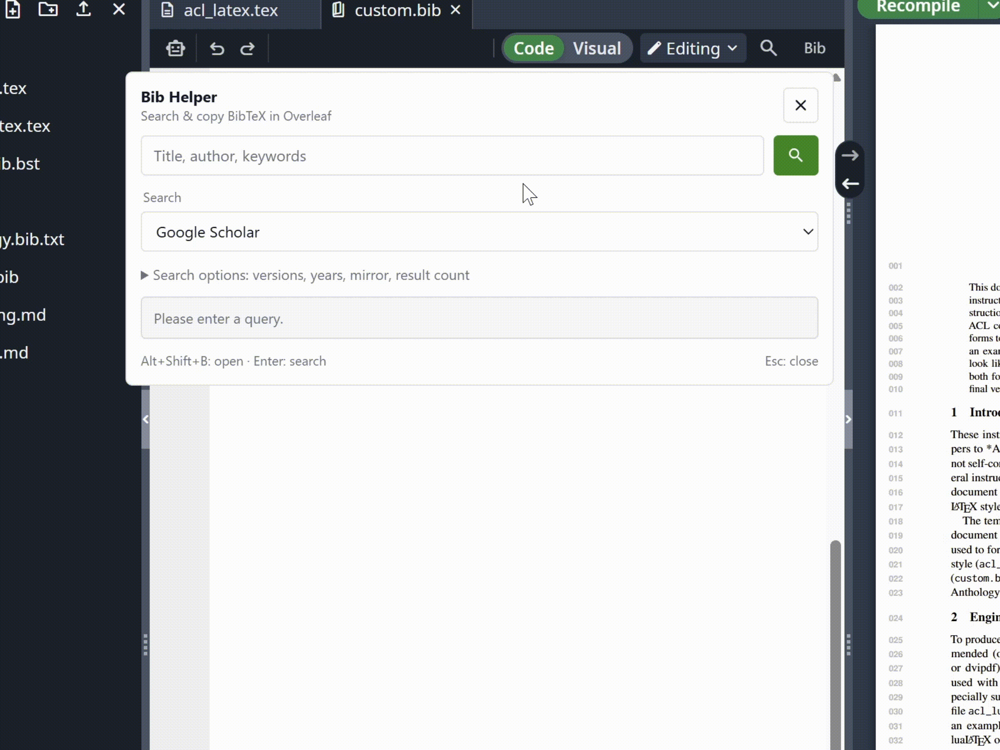

  
  <h1>Overleaf-Bib-Helper</h1>

  A UserScript to enhance Overleaf by allowing article searches and BibTeX retrieval from DBLP and Google Scholar directly within the Overleaf editor.

  
  
  
  
  
  
  

      <a href="#motivation">Motivation</a> •
      <a href="#changelog">Changelog</a> •
      <a href="#installation">Installation</a> •
      <a href="#usage">Usage</a> •
      <a href="#supported-sources">Supported Sources</a> •
      <a href="#troubleshooting">Troubleshooting</a> •
      <a href="#disclaimer">Disclaimer</a> •
      <a href="#contact-and-contributing">Contact and Contributing</a> •
      <a href="#acknowledgments">Acknowledgments</a>
    

[中文](./README.md) | English

- **Official BibTeX aggregation**: Covers NeurIPS, PMLR, ACL, OpenReview, CVF, ECVA/Springer, BMVC, AAAI, IJCAI, KR, ACM, IEEE; shows provenance + DBLP fallback.
- **Seamless Overleaf integration**: Supports old/new toolbars, auto-restores `Bib` after file/layout switches, follows light/dark themes, works in small windows.
- **Quick invoke, one-click cite**: Open via `Alt+Shift+B` or menu; selected titles auto-fill search; supports DBLP / Google Scholar and mirrors; preview/edit BibTeX, edit/copy keys or `\cite{key}`, download `.bib`.
- **Smart results & versions**: Merge same-title entries into “Versions (n)” with one-click “Copy best”; DBLP favors official versions, downranks arXiv/CoRR; supports year filters, sorting, result counts (5/10/20/50).

## Installation
### Step 1: Install Tampermonkey
Tampermonkey is a browser extension required to run UserScripts like Overleaf-Bib-Helper. Follow these steps:
1. **Download Tampermonkey**:
   - **Chrome**: [Chrome Web Store](https://chrome.google.com/webstore/detail/tampermonkey/dhdgffkkebhmkfjojejmpbldmpobfkfo)
   - **Firefox**: [Mozilla Add-ons](https://addons.mozilla.org/en-US/firefox/addon/tampermonkey/)
   - **Edge**: [Microsoft Edge Add-ons](https://microsoftedge.microsoft.com/addons/detail/%E7%AF%A1%E6%94%B9%E7%8C%B4/iikmkjmpaadaobahmlepeloendndfphd)
   - **Safari**: [App Store](https://apps.apple.com/us/app/tampermonkey/id1482490089) (requires macOS)

### Step 2: Install Overleaf-Bib-Helper
You can install the script in one of two ways:

#### Option 2: Install from GitHub
1. Go to the [GitHub repository](https://github.com/mahmud0x/Overleaf-Bib-Helper).
2. Open the `Overleaf-Bib-Helper.js` file in the repository.
3. Copy the entire script content.
4. In your browser, click the Tampermonkey icon > **"Create a new script"**.
5. Paste the copied code into the editor, replacing the default template.
6. Click **File > Save** in the Tampermonkey editor.
7. The script will be active on Overleaf project pages.
8. This script includes the canonical Greasy Fork update URLs, so manually installed copies can receive updates through Tampermonkey.

## Usage
### Opening the Tool
1. Open an Overleaf project in your browser (`https://www.overleaf.com/project/*`).
2. Click **Bib** on the right of the editor toolbar. When the editor toolbar is hidden, the helper uses the project toolbar.
3. You can also press **Alt+Shift+B** or select **Open Bib Helper** from the Tampermonkey menu. Select a paper title before opening to prefill the search.

### Searching for Articles
1. **Enter a Query**: Type your search term (e.g., article title, author, or keywords) into the input field.
2. **Select Search**: Choose "DBLP" or "Google Scholar" from the "Search" dropdown.
   - **DBLP**: Best for computer science literature with structured data.
   - **Google Scholar**: Broader coverage across various fields but may require CAPTCHA verification.
   - With DBLP, **BibTeX → Official venue when available** retrieves the original export from supported official publication links. Choose **DBLP** to use DBLP's export instead.
3. **Set Result Count**: Select 5, 10, 20, or 50 results from the "Results" dropdown.
4. **Start Search**:
   - Press the **Enter** key or click the magnifying glass icon.
   - Expand **Search options** for versions, years, mirror, ordering, and result count. DBLP filtering and ordering apply to a bounded set of up to 200 candidates, not the entire database.
5. Results will appear in a scrollable list below the input field.

## Troubleshooting

 <b>Script Not Working?</b> 

- Allow Tampermonkey to run userscripts using **Allow User Scripts** or extension **Developer Mode**.
- If the Bib button is missing, try **Alt+Shift+B** or the Tampermonkey menu and verify that you have v2.2.1 installed.
- Ensure Tampermonkey is enabled and the script is active.
- Verify you’re on an Overleaf project page.
- Reload or reinstall from Greasy Fork.

 <b>No Results?</b> 

- Check your query for typos.
- Ensure you have granted the plugin search permissions.
- Try switching between DBLP and Google Scholar.
- DBLP may also show a browser verification page. Use **Open verification page**, allow the site to complete its check, and retry.

 <b>Google Scholar Issues?</b> 

- Click **Open verification page** in the helper, complete verification in that tab, and retry; or choose **Search DBLP instead**.
- Scholar may restrict automated requests even when its homepage loads. Switch mirrors or use the Source link to obtain the citation manually.

## Disclaimer
While Overleaf-Bib-Helper aims to provide a seamless experience, please note that it relies on external services (DBLP and Google Scholar) which may change their APIs or require user verification (e.g., CAPTCHA). Use this tool at your own discretion and always verify retrieved BibTeX entries before including them in your documents.

## Contact and Contributing
Please email [Xunjian Yin](mailto:xjyin@pku.edu.cn) or create Github issues here if you have any questions or suggestions. Feel free to fork the [GitHub repository](https://github.com/MLNLP-World/Overleaf-Bib-Helper), submit issues, or create pull requests with improvements!

## Acknowledgments
### Organizers
We would like to thank the following students for organizing and guiding this project:

### Contributors
We would like to thank the following students for their support and contributions to this project:

&nbsp;

&nbsp;

